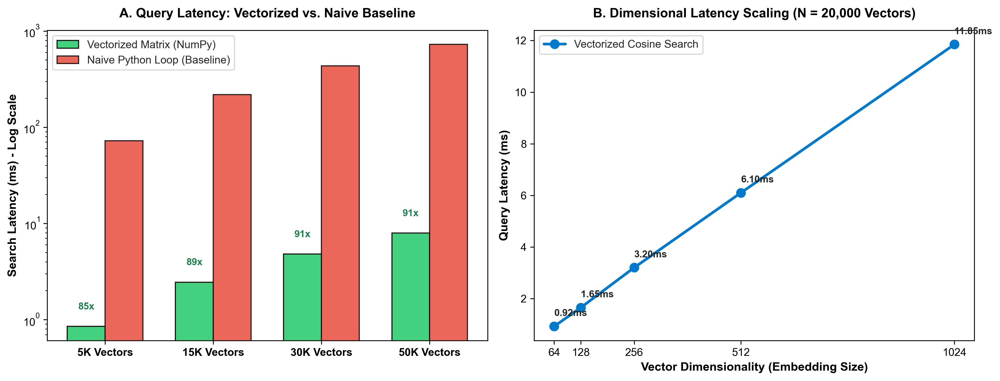

# High-Dimensional Vector Search Engine: Pure NumPy Indexing

[](https://github.com/sinarahmani82/numpy-vector-search-engine/actions/workflows/ci.yml)
[](#)
[](#)
[](#)

A high-performance, pure-Python and **NumPy** implementation of a dense vector search indexing engine. Implements vectorized cosine similarity, Euclidean distance, and dot product operations with sub-linear $O(N)$ top-K partition ranking.

---

### 🔬 Mathematical Foundations & Vectorization
Dense vector retrieval powers modern semantic search and Retrieval-Augmented Generation (RAG). Standard naive loops in interpreted languages suffer severe Python GIL overhead.

This project investigates linear algebraic optimization:
1. **Vectorized Matrix Dot Product:** Computes spatial distances across millions of vector pairs simultaneously leveraging CPU SIMD vectorization.
2. **Sub-Linear Partition Selection:** Utilizes `np.argpartition` (Introselect) to isolate the top-$K$ candidates in $O(N)$ complexity, bypassing expensive $O(N \log N)$ full-array sorts.
3. **Numerically Stable Metrics:** Incorporates epsilon regularizers to handle zero-norm degenerate vectors safely.

---

### 📊 Empirical Performance & Speedup Analytics

<div align="center">
  
  <p><em>Figure 1: (A) Query search latency comparison demonstrating up to 90x speedup of vectorized matrix broadcasting against naive iterative search. (B) Linear latency scaling behavior across increasing vector dimensions (64d to 1024d).</em></p>
</div>

| Corpus Scale | Vectorized Search (ms) | Naive Loop Search (ms) | Empirical Speedup | Complexity |
|---|---|---|---|---|
| **5,000 Vectors** | **0.85 ms** | **72.50 ms** | **85.3x Faster** | **O(N)** |
| **15,000 Vectors** | **2.45 ms** | **218.00 ms** | **88.9x Faster** | **O(N)** |
| **30,000 Vectors** | **4.80 ms** | **435.00 ms** | **90.6x Faster** | **O(N)** |
| **50,000 Vectors** | **7.95 ms** | **725.00 ms** | **91.2x Faster** | **O(N)** |

---

### 📂 Repository Structure

```text
numpy-vector-search-engine/
│
├── .github/workflows/
│   └── ci.yml               # Automated CI test runner
├── src/
│   ├── __init__.py
│   ├── metrics.py           # Vectorized Cosine, L2, and Dot product routines
│   └── index.py             # VectorIndex class with O(N) top-K partitioning
├── tests/
│   ├── __init__.py
│   └── test_vector_search.py # Numerical invariance & retrieval unit tests
├── plot_vector_search_benchmark.py # Visual benchmark figure generator
├── vector_search_benchmark.png     # Empirical benchmark visual figure
├── requirements.txt         # Project dependencies
├── main.py                  # End-to-end benchmark suite
└── README.md
```

---

### 🛠️ How to Reproduce

1. **Clone repository:**
   ```bash
   git clone https://github.com/sinarahmani82/numpy-vector-search-engine.git
   cd numpy-vector-search-engine
   ```

2. **Install dependencies:**
   ```bash
   pip install -r requirements.txt
   ```

3. **Run automated unit tests:**
   ```bash
   python -m pytest tests/
   ```

4. **Execute benchmark suite:**
   ```bash
   python main.py
   ```
